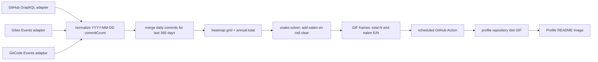

# GitCode 接入与年度贡献统计二开可行性评估

## 1. 背景与目标

当前项目基于 Platane/snk 派生，已有 GitHub 与 Gitee 数据源，主要产物是贡献热力格子的蛇形动画（SVG/GIF）。本次评估目标是确认加入 GitCode 日统计并跨平台合并、显示年度提交数、按年份切换的可行性和改造边界。

本次先评估数据口径和 README 展示约束，随后按评估结论完成仓库内二开。目标场景为 GitHub 个人 Profile README：由 GitHub Actions 定时更新静态 GIF，展示最近 365 天三平台合并热力图、总提交数和动画当前已吃掉的提交数。真实 GitHub、Gitee、GitCode 账号 API 尚未调用。

## 2. 现状与关键证据

### 2.1 数据适配和合并

- GitHub 保留旧的 contribution-calendar 适配器供现有 demo/service 使用；Action 新增纯提交数 GraphQL 适配器，按 31 天分块取日提交数，并用 `totalCommitContributions` 对账。私有仓库统计需要带 `read:user` 的个人 token。
- Gitee 适配器改为读取 PushEvent，按 `prev_id` 游标逐页取数；GitCode 新增用户动态适配器，按涉及年份查询并跟随 `next` 游标。
- 新公共模型使用 `{ date, count }`，聚合器按 UTC 日期合并启用的平台，补齐零提交日期后再生成格子。`generateContributionSnake` 将总数和按格子计数传入 GIF。
- `packages/demo/demo.interactive.ts` 是 GitHub 用户名输入的浏览器演示，不是完整的多平台统计页面；当前没有年份选择器或年度提交总数展示。

### 2.2 Action 发布方式

改造前根目录 `action.yml` 固定指向 `pray0/multi-source-snake:v1.6`，fork 用户可能运行上游镜像。当前已改为 `image: Dockerfile`，引用 fork 时从 fork 的 Dockerfile 构建。

改造前 `packages/action/index.ts` 与 GitHub 适配器会记录 token；当前已移除凭据日志，新的 GitHub/Gitee/GitCode 适配器也不会把 token 写入日志或 URL。

## 3. GitCode API 能力

GitCode 官方用户动态接口为 `GET /api/v5/users/:username/events`，支持 `year` 查询参数和 `next` 日期游标；响应按日期分组。Push 动态中的 `push_data.commit_count` 可作为该次推送包含的提交数。这与按日热力图和年度聚合所需的数据形状基本匹配。

接口文档要求授权信息，GitCode REST API 指南列出了 Personal Access Token 认证方式。接入时应使用 GitHub Actions Secrets 保存 token，并确认该用户 token 能访问其需要统计的动态。官方文档没有明确承诺任意早期年份的完整历史保留范围，较早年份需通过真实账号验证。

参考：

- [GitCode 用户个人动态接口](https://docs.gitcode.com/en/docs/apis/get-api-v-5-users-username-events/)
- [GitCode REST API 指南](https://docs.gitcode.com/en/docs/guide/)
- [GitHub GraphQL Users：贡献日历与 ContributionsCollection](https://docs.github.com/en/graphql/reference/users)

GitHub GraphQL 的 `contributionsCollection` 支持 `from` / `to` 日期范围，并暴露 `totalCommitContributions`。这能支持按日历年查询和单独取年度提交总数。但当前日历字段 `ContributionCalendarDay.contributionCount` 的语义是“该日贡献数”，包含 GitHub 贡献图中的多种贡献，并非纯提交数。

## 4. 可行性结论

**总体可行，改造范围中等。** GitCode 不需要新建服务或改变蛇形动画寻路算法，新增数据适配器、滚动窗口输入和公共日期归一化/合并即可接入渲染链路。

可行性分项：

| 需求                      | 可行性                 | 主要改动                                                                                                                 |
| ------------------------- | ---------------------- | ------------------------------------------------------------------------------------------------------------------------ |
| GitCode 按日统计          | 高                     | 新增 `gitcode-user-contribution` 适配器，解析按日分组的事件，筛选 Push 并累计 `commit_count`，沿 `next` 游标读取完整年份 |
| GitHub/Gitee/GitCode 合并 | 高                     | 以 `YYYY-MM-DD` 为 key 聚合各来源日数据，再生成完整年度日期格子和周坐标                                                  |
| 年度提交总数              | 高，但依赖口径         | 分平台取提交数后求和；不要直接把 GitHub 日历的 `contributionCount` 标成提交数                                            |
| Action 时间窗口           | 高                     | 已实现可配置 `WINDOW_DAYS`（默认 365，范围 1–366），工作流每次生成对应的滚动 UTC 窗口                                    |
| README 访客切换年份       | 单张 README 图片不支持 | README 图片是静态产物；访客不能在图片内交互切换年份，因此首期采用最近 365 天默认窗口                                     |
| fork 后实际运行二开代码   | 必须处理               | 更换固定的上游 Docker 镜像配置，确保 fork 使用自身构建/发布的镜像或仓库 Dockerfile                                       |

## 5. 推荐数据与统计方案

### 5.1 统计口径：三平台都按提交数

本次目标明确为近一年“提交数”和“已吃掉的提交数”，因此推荐热力图、年总数和蛇的吃取计数都使用同一种日提交数：GitHub 取 commit contributions，Gitee/GitCode 取 Push 动态中的提交数。不要把 GitHub `ContributionCalendarDay.contributionCount` 直接当作 commit，因为它统计 issues、commits、PR 等多类贡献。

GitHub 的 `ContributionsCollection.totalCommitContributions` 可用于汇总/核验区间总提交数；按日数据从 `commitContributionsByRepository` 中逐日累加。该字段按仓库分组，API 默认最多返回 25 个仓库；实际实现显式请求 100 个仓库并把逐日和与总数对账。若仓库覆盖仍不足或私有贡献权限不可见，对账失败会中止生成，避免静默显示偏小的总数。私有仓库贡献受 `read:user` scope 和用户隐私设置影响。

三平台按日合并的结果是“平台提交数合计”。同一 commit 如果镜像到多个平台，目前没有统一的跨平台 commit identity 可以可靠去重，因此不能称作全球唯一 commit 数。

### 5.2 公共日期模型与年份范围

适配器统一输出 `{ date: "YYYY-MM-DD", count }`，以 ISO 日期作为合并键，不让 GitHub 的周坐标成为其他平台的主键。各来源分别返回日列表，聚合器按日求和后，再补齐空日期并生成网格和等级。

默认窗口为滚动近 365 天，范围为 UTC 日期 `today - 364` 至 `today`（含首尾，共 365 个自然日）；GitHub GraphQL 传入 `from/to`。GitCode 接口以自然年作为查询参数，近 365 天跨年时读取涉及的年份，再按统一日期窗口过滤，并跟随 `next` 直到没有下一页。Gitee 使用 `limit=100` 和 `prev_id` 游标分页，最多读取 1000 页并在最旧事件早于窗口时提前停止。

### 5.3 输出交互范围

GitHub 个人 README 可以用 Markdown 图片或 `<picture>` 展示生成后的 SVG/GIF，因此把 GitCode 合并后的热力图和统计数生成为图片是可行的。README 里的图片是静态资源，访客不能在图中操作年份选择器；GitHub 文档也说明 SVG 页面不支持内联脚本或动画。若要求动画稳定展示，应优先验证 GIF；若只展示热力图和总数，可生成静态 SVG/PNG。

对个人 README，推荐定时 Action 生成同一路径的 GIF，默认近 365 天。Profile README 支持通过 GitHub Flavored Markdown 展示 GIF；访问者看到的是已生成图片，不能在该图片内点击切换年份。维护者当然可以通过 Action 的手动输入切换生成窗口，但结果只会覆盖图片，不能给 README 访客提供按需切换。近一年默认值满足此场景，历史年切换不纳入首期。

GIF 每一帧在画布顶部留白区显示 `Last 365 days: N commits | Eaten: E/N`。模拟蛇走时，只有 `step()` 实际清空一个非空日期格子才增加 eaten；增加量为该日提交数，所以一格可能让 E 跳增多个提交。动画最终帧应满足 `E = N`。这比把“蛇走过的格子数”误标成“吃掉的提交数”准确。

## 6. 风险与防护

1. **统计口径混合。** 旧 GitHub 热力日历日值是广义贡献数，GitCode/Gitee Push 动态是提交数。Action 已单独改用 GitHub 按日提交统计，并与另外两平台的 Push commit_count 合并、用 GitHub 区间总数核验。
2. **镜像仓库重复计数。** 同一提交在多个平台镜像仓库出现时，按平台日值直接相加可能重复。当前 API 形状没有足够的逐提交身份数据来可靠跨平台去重；总数应说明为“平台统计合计”。
3. **历史范围与分页。** Gitee `prev_id` 和 GitCode `year/next` 游标及安全页数限制已实现，但尚未通过真实账号验证 API 的终止和历史覆盖。GitHub 逐日分块并与区间总数对账。
4. **认证与密钥。** 各 token 通过 GitHub Actions Secrets 注入并放入请求头；Action/GitHub adapter 原有 token 日志已清理，请求错误不打印完整 URL。
5. **发布链路。** Action 已改为 fork 自有 Dockerfile；仍需发布 `v1` 标签并在 Profile 仓库 workflow 中引用。
6. **时区边界。** GitHub 日期时间和 Gitee `created_at` 统一按 UTC 日切分，GitCode 使用其按日期分组的键。平台对活动日期的归属可能仍存在差异，需在目标账号核对跨 UTC 午夜的活动；这属于尚未完成的真实 API 验证。

## 7. 实施进度与待办

1. 已确定所有平台统一统计提交数，默认最近 365 个 UTC 自然日；README 图片不提供访客侧年份选择。
2. 已增加 GitHub、Gitee、GitCode 按日适配器、UTC 日期窗口、跨平台聚合、分页保护和 fixture。
3. 已将 Action 改为从 fork 自己的 Dockerfile 构建，并让 GIF 显示总提交数和蛇已吃提交数。
4. Profile README workflow 与图片引用模板已写入项目 README；实际发布标签、Secrets/Variables 配置和 hosted runner 端到端验证仍待执行。

## 8. 当前验证状态

- Jest：排除依赖原生 `canvas.node` 的 `packages/gif-creator/__tests__/createGif.spec.ts` 后，18 个测试套件、85 个测试通过。
- `yarn type` 通过；在 `packages/action` 下执行 `yarn build`，ncc Action bundle 构建通过。
- 完整 GIF 集成测试受本机环境阻塞：Windows Node 22 预编译下载遇到 TLS 连接中断，node-gyp 回退后因机器没有 Visual Studio C++ Build Tools 而失败。Docker 镜像构建因 Docker Desktop Linux Engine 未启动，无法连接 daemon。
- 未使用真实 GitHub/Gitee/GitCode token 调用外部 API；目标账号上的分页、权限和数据覆盖仍待 smoke test。

## 9. 主流落地模式调研

| 模式                           | 主流做法                                                                                                  | 对本需求的适配                                                                    |
| ------------------------------ | --------------------------------------------------------------------------------------------------------- | --------------------------------------------------------------------------------- |
| `Platane/snk`                  | GitHub Actions 定时生成 SVG/GIF，图片存入仓库，再引用到 Profile README                                    | 与现有项目算法和目标展示方式最接近，建议沿用其静态产物模式                        |
| `github-readme-stats`          | 动态服务按请求生成卡片；其文档也建议可用 GitHub Actions 生成静态图片，降低公共服务不稳定和访问 API 的依赖 | GitCode 私密 token 不适合嵌进公开 URL，因此采用 Action 在后台取数、静态图对外展示 |
| `github-profile-summary-cards` | Action 生成 SVG 资产，落入个人仓库后从 README 引用                                                        | 可参考其权限和提交资产方式，合并平台统计仍需本项目自己的适配器                    |

综合建议是“Action 定时运行 + 静态 GIF 入库 + README 相对路径引用”。这条路径不需要常驻 Web 服务，token 留在 GitHub Actions Secrets 中，README 图片只公开汇总数字和热力图。

## 10. 推荐二开架构



建议保持 provider adapters 只负责 API 认证、分页和来源内解析；公共聚合模块负责 UTC 日期窗口和合并；绘制层只接收标准化 daily commit records。这样 GitCode 后续 API 差异不会渗入蛇算法。

Action 新输入：`GITCODE_USER`、`GITCODE_TOKEN` 和默认 `WINDOW_DAYS=365`。Gitee 输入也已设为可选；未配置的平台会跳过。GitHub token 用于读数据，工作流内置 `GITHUB_TOKEN` 用于提交图片；要统计私有贡献，应把 Action 的 `GITHUB_TOKEN` 输入指向自定义 PAT Secret（例如 `GH_CONTRIBUTION_TOKEN`），并授予 `read:user`。

## 11. 目标使用配置（完成二开并发布 `v1` 后可复制）

### 11.1 Fork Action 仓库必须做的适配

1. 已在 `action.yml` 增加 `GITCODE_USER`、`GITCODE_TOKEN`、`WINDOW_DAYS` 输入，非 GitHub provider 可不配置而跳过。
2. 已把固定上游镜像改为 fork 自身源码构建：

   ```yaml
   runs:
     using: docker
     image: Dockerfile
   ```

3. 已删除 Dockerfile 中写死的内网代理。
4. 已清理 token 日志，并实现公共数据模型、总数与 eaten 帧统计。
5. 已将 Dockerfile 升级到 Node 22 / Canvas 3；当前本机缺少原生构建工具且网络阻断预编译下载，Docker clean build 与实际 GIF 渲染仍待 CI 验证。
6. 完成后需在 fork 发布 `v1` 标签，再由 Profile README workflow 引用。

### 11.2 个人 Profile 仓库工作流

在 `USERNAME/USERNAME` profile 仓库添加 `.github/workflows/contribution-snake.yml`，将 `YOUR_FORK_OWNER` 替换为 fork 所有者。先在仓库 `Settings → Secrets and variables → Actions` 配置 `GITCODE_TOKEN`、`GITEE_TOKEN`；普通 GitHub 公共贡献可以使用内置 token。有私有贡献读取需求时配置带 `read:user` 的 PAT Secret（如 `GH_CONTRIBUTION_TOKEN`），并把 Action 的 `GITHUB_TOKEN` 行换成该 Secret。用户名放到 Actions Variables：`GITCODE_USER`、`GITEE_USER`。

```yaml
name: Update multi-source contribution snake

on:
  schedule:
    - cron: "17 2 * * *" # UTC 每日运行
  workflow_dispatch:

permissions:
  contents: write

jobs:
  generate:
    runs-on: ubuntu-latest
    steps:
      - uses: actions/checkout@v7

      - name: Generate last-365-day snake
        uses: YOUR_FORK_OWNER/MultiSourceSnake@v1
        with:
          GITHUB_USER: ${{ github.repository_owner }}
          GITHUB_TOKEN: ${{ secrets.GITHUB_TOKEN }} # Private data: secrets.GH_CONTRIBUTION_TOKEN
          GITEE_USER: ${{ vars.GITEE_USER }}
          GITEE_TOKEN: ${{ secrets.GITEE_TOKEN }}
          GITCODE_USER: ${{ vars.GITCODE_USER }}
          GITCODE_TOKEN: ${{ secrets.GITCODE_TOKEN }}
          WINDOW_DAYS: "365"
          outputs: |
            /github/workspace/dist/multisource-snake.gif

      - name: Commit generated image
        run: |
          git config user.name "github-actions[bot]"
          git config user.email "41898282+github-actions[bot]@users.noreply.github.com"
          git add dist/multisource-snake.gif
          if git diff --cached --quiet; then
            echo "No image changes"
            exit 0
          fi
          git commit -m "chore: update contribution snake"
          git push
```

Profile `README.md` 直接引用仓库中的文件：

```markdown

```

GitHub 官方文档确认 Profile README 可展示图片和 GIF；上游 `snk` 的常见用法同样是用 Actions 自动生成 GIF/SVG 并写进 README。上面的 workflow 是改造完成并发布 fork Action 后的目标配置，不是当前仓库原样即可运行的配置。

## 12. 验收和上线前核对

- 用 fixtures 覆盖 365 日窗口首尾、跨年、闰日、同日多平台叠加、无活动日期、GitCode `next` 多页和 Gitee 多页。
- GitHub 日粒度 commits 求和与 `totalCommitContributions` 对账；超出仓库覆盖上限时应提示不完整。
- 验证热力图的 N 等于所有每日提交数总和，蛇每次吃格增加当天提交数，最终 E 等于 N。
- 在新建的临时 profile 测试仓库跑 `workflow_dispatch`，观察 GitHub-hosted runner 构建 fork Action、写出 GIF、提交图片、README 正确渲染；再观察至少一次 schedule。
- 在拟采用的受支持 Node LTS 容器中完成 clean build 和 GIF smoke test，确认 `canvas` 原生依赖可安装并能渲染。
- 审查 Action 日志，确认没有 GitHub/Gitee/GitCode token 或带 token 的请求 URL。

## 13. 最终结论

个人 README 方案已按“最近 365 天滚动窗口 + 定时 Action + 仓库内 GIF + README 相对路径引用”实现。GIF 每帧显示窗口总提交数和蛇已吃提交数；GitHub、Gitee、GitCode 按 UTC 日期合并。README 访客不能切换年份；若要历史年份，需要维护者重新生成另一份静态产物，首期未实现 `YEAR` 输入。

Action metadata 使用仓库 `Dockerfile`，fork 工作流构建 fork 自己的代码，不再拉取旧上游镜像；Dockerfile 已删除内网代理并采用 Node 22 / Canvas 3。项目 README 含 profile workflow 与图片嵌入模板。对外引用前仍需在 fork 发布 `v1` 标签并配置 Secrets/Variables。

已通过纯逻辑单测、TypeScript 检查和 Action bundle 构建。尚未验证 Docker 镜像 clean build、原生 Canvas GIF 集成测试、真实平台 API smoke test，以及 GitHub hosted runner 写回 Profile README 的端到端流程。

## 14. 调研参考

- [Platane/snk README：Action 定时生成 SVG/GIF 并嵌入 Profile README](https://github.com/Platane/snk/blob/main/README.md)
- [GitHub 文档：Profile README 支持图片与 GIF](https://docs.github.com/en/account-and-profile/concepts/personal-profile)
- [GitHub GraphQL Users：提交贡献、贡献日历与查询时间窗](https://docs.github.com/en/graphql/reference/users)
- [GitCode 官方文档：Get User Personal Dynamics](https://docs.gitcode.com/en/docs/apis/get-api-v-5-users-username-events/)
- [GitHub Actions 工作流语法：schedule 与权限](https://docs.github.com/en/actions/reference/workflows-and-actions/workflow-syntax)
- [GitHub Actions Docker action metadata](https://docs.github.com/en/actions/reference/workflows-and-actions/metadata-syntax)
- [actions/checkout 官方仓库与当前主版本示例](https://github.com/actions/checkout)
- [github-readme-stats：动态卡片和静态 Action 思路](https://github.com/anuraghazra/github-readme-stats)
- [github-profile-summary-cards：Action 生成 Profile SVG 资产](https://github.com/vn7n24fzkq/github-profile-summary-cards)
- [Node.js 官方版本状态：Node 18 已 EOL](https://nodejs.org/en/about/eol)
- [node-canvas 官方仓库：Node.js 与原生安装要求](https://github.com/Automattic/node-canvas)
